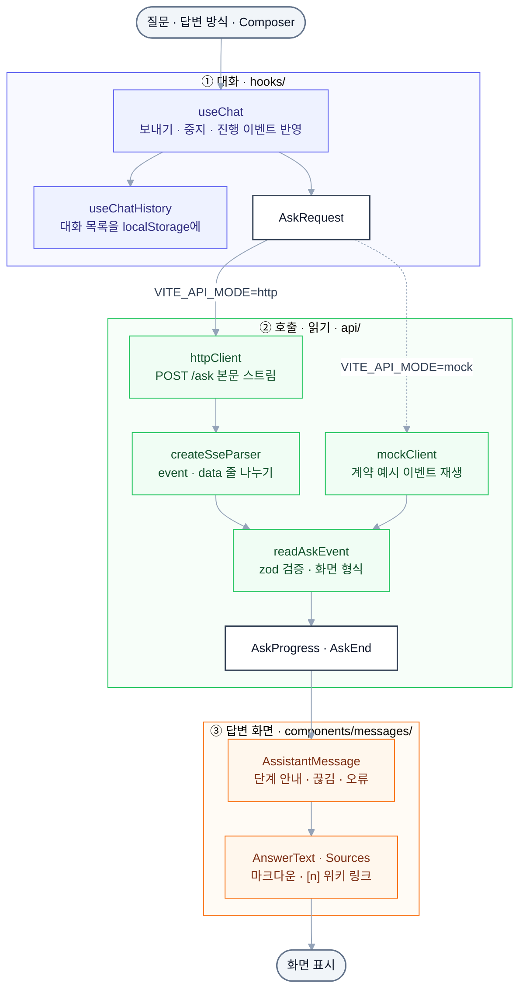

# llm-playground-web

[llm-playground-wiki](https://github.com/calm-sea-psy/llm-playground-wiki) API에 붙여 쓰는 위키백과 Q&A 채팅 화면입니다. 질문을 `POST /ask`로 보내고, 서버가 흘려 보내는 이벤트 스트림(SSE)을 받아 진행 단계 안내 · 흘러 들어오는 답 · 위키백과 출처 링크를 보여 줍니다. 답변 방식은 단발과 에이전트(`?mode=agent`) 중에서 고르고, 서버 없이 계약 예시를 재생하는 목업으로도 화면을 돌려 볼 수 있습니다.

## 전체 흐름



## 폴더 구조

```
llm-playground-web/
├─ src/
│  ├─ api/          wiki 계약 · 호출 (client.ts · httpClient.ts · sse.ts · responses.ts · mockClient.ts · generated/)
│  ├─ hooks/        대화(useChat) · 대화 목록 저장(useChatHistory) · 서버 상태(useHealth) · 화면 보조 훅
│  ├─ lib/          순수 함수 · 설정 (config.ts · chat.ts · history.ts · sources.ts · citations.ts · dates.ts · labels.ts · logger.ts)
│  ├─ components/   화면 (AppHeader · ChatView · Composer · Sidebar · Sources · messages/ · seal/ 답변 대기 물개)
│  ├─ providers/    API 클라이언트 · 저장소 주입 (ApiProvider · StorageProvider)
│  ├─ App.tsx       화면 조립 (사이드바 · 머리줄 · 대화 · 입력창)
│  └─ main.tsx      시작점. VITE_API_MODE로 실제 · 목업 클라이언트를 골라 주입
├─ contracts/       wiki API 계약 사본 (openapi.json · examples/ · manifest.json · CHANGELOG.md)
├─ scripts/         계약 가져오기(sync-contracts.mjs) · 타입 생성(gen-schemas.mjs · schema-descriptions.mjs)
├─ server/          화면 로그 서버 (Express · winston). 루트 package.json 의 워크스페이스 패키지
├─ shared/          화면과 로그 서버가 함께 쓰는 로그 형식 (clientLog.ts)
├─ docker/          nginx 설정 (nginx.conf.template)
├─ logs/            화면 로그 파일 (git 제외)
├─ Dockerfile       빌드(Node) → 화면(nginx) · 로그 서버 이미지
├─ compose.yaml     Docker 실행 (web · log-server)
├─ .env.example     설정 견본
├─ vite.config.ts   개발 서버 · /health · /ask · /search 프록시
└─ package.json     의존성 · 스크립트 (npm), 따라가는 계약 버전(wikiContract)
```

## 기술 스택

| 구분               | 사용                                                               |
| ------------------ | ------------------------------------------------------------------ |
| 언어 · 환경        | TypeScript 5.9, Node.js 24, npm                                    |
| 화면               | React 19, Vite 8, Tailwind CSS 4 (typography)                      |
| 서버 데이터 · 검증 | TanStack Query 5, zod 4                                            |
| 답변 표시          | react-markdown, remark-gfm                                         |
| 계약 타입 생성     | openapi-typescript, `scripts/gen-schemas.mjs`                      |
| 화면 로그 서버     | Express 5, winston (날짜별 파일)                                   |
| 실행 · 서빙        | Docker Compose, nginx (`nginx:1.29-alpine`)                        |
| 백엔드 (별도)      | llm-playground-wiki — `GET /health` · `POST /ask` · `POST /search` |

## 빠르게 실행해 보기

[Node.js](https://nodejs.org/) 24와 npm, 그리고 옆에 clone한 llm-playground-wiki를 띄울 [uv](https://docs.astral.sh/uv/)가 설치돼 있는 상태에서 시작합니다. wiki는 목업 모드(`RAG_IMPL=mock`)로 띄우므로 PostgreSQL · Qdrant · Ollama · GPU가 없어도 됩니다.

### 1. 패키지 설치

```bash
npm ci
```

`npm ci`는 `package-lock.json` 그대로 화면과 로그 서버(`server/`) 패키지를 설치합니다.

### 2. wiki 목업 서버 띄우기

llm-playground-wiki 레포 루트에서 실행합니다 (`uv sync`를 한 번 해 둔 상태).

```bash
RAG_IMPL=mock uv run uvicorn playground_wiki.api.app:create_app --factory --host 127.0.0.1 --port 8000
```

PowerShell에서는 `$env:RAG_IMPL="mock"; uv run uvicorn playground_wiki.api.app:create_app --factory --host 127.0.0.1 --port 8000`입니다. 목업 서버는 계약 예시와 같은 이벤트 순서로 답하고, 답 조각을 단어마다 0.03초 간격으로 흘립니다.

### 3. 개발 서버 띄우기

이 레포 루트에 `.env.local`을 만들어 실제 서버에 붙도록 정합니다.

```bash
echo "VITE_API_MODE=http" > .env.local
npm run dev
```

PowerShell의 `echo >`는 UTF-16으로 저장해 Vite가 읽지 못하므로 `Set-Content .env.local "VITE_API_MODE=http" -Encoding ascii`로 만듭니다. `npm run dev`는 http://localhost:5173 에 화면을 띄우고, `/health` · `/ask` · `/search`를 `http://127.0.0.1:8000`으로 넘깁니다. 8000 포트를 다른 서버가 쓰고 있으면 wiki를 다른 포트로 띄우고 `.env.local`에 `WIKI_URL=http://127.0.0.1:<포트>`를 더합니다.

### 4. 확인

http://localhost:5173 을 열어 사이드바 아래가 "서버 정상"이면 붙은 것입니다 (실제 데이터로 띄운 wiki면 그 아래에 "Qdrant (local)" · "Qdrant (cloud)"처럼 검색이 붙은 Qdrant 위치가 나오고, 목업 wiki는 위치가 없습니다). 예시 질문 "경복궁을 중건한 사람은?"을 보내면 답이 흘러 들어오고, 답 속 `[1]` · 아래 출처 목록이 위키백과 문서로 이어집니다. 질문 끝에 꼬리표를 붙이면 다른 경로를 볼 수 있습니다.

| 질문                   | 화면                                                                                     |
| ---------------------- | ---------------------------------------------------------------------------------------- |
| 꼬리표 없음            | grounded — 출처 번호 붙은 답 · 출처 목록 (답에 나오지 않은 출처는 흐리게)                |
| `#못찾음`              | grounded → partial — "위키백과 문서에서" · "문서 밖 일반 지식" 두 칸 답과 일반 지식 안내 |
| `#일반` + 에이전트     | 질문 나누기 → 검색 → 판단 단계 안내 뒤 답                                                |
| `#거절` · `안녕하세요` | refuse · 질문 관문 고정 문구                                                             |
| `#생성오류`            | 빨간 상자에 서버의 오류 문구                                                             |

### 5. (선택) 서버 없이 목업으로 보기

`.env.local`이 없으면(또는 `VITE_API_MODE=mock`) `npm run dev`는 서버 없이 `contracts/examples/ask_*.json`의 이벤트 열을 재생합니다. 꼬리표는 위 표와 같게 고르고, 사이드바는 늘 "서버 정상"입니다 (Qdrant 위치 없음).

### 6. (선택) Docker로 띄우기

```bash
docker compose up -d --build
```

`compose.yaml`은 화면을 빌드해 nginx(web)를 8080 포트에, 화면 로그 서버(log-server)를 그 뒤에 띄웁니다. nginx는 `/health` · `/ask` · `/search`를 `BACKEND_URL`(기본 `http://host.docker.internal:8000`)로 넘기므로, 컨테이너에서 닿도록 wiki를 `--host 0.0.0.0`으로 띄웁니다. http://localhost:8080 에서 확인하고, 멈출 때는 `docker compose down`입니다.

## 설정

docker compose는 `.env`를, 개발 서버는 `.env` · `.env.local`을 읽습니다 (견본 [.env.example](.env.example)).

| 항목                      | 변수            | 값 · 기본값                                                                                | 없으면                                     |
| ------------------------- | --------------- | ------------------------------------------------------------------------------------------ | ------------------------------------------ |
| API 연결 방식             | `VITE_API_MODE` | `http` (실제 wiki) · `mock` (계약 예시 재생). 빌드 때 정해져 바꾸면 다시 빌드              | 개발 서버는 `mock`, 빌드 · Docker는 `http` |
| API 주소                  | `VITE_API_BASE` | 다른 주소의 wiki를 직접 부를 때 `http://주소:포트` (wiki에 CORS 설정이 없어 막힘)          | 같은 주소로 보내고 프록시가 넘긴다         |
| wiki 주소 (개발 서버)     | `WIKI_URL`      | 개발 서버 프록시가 넘길 주소                                                               | `http://127.0.0.1:8000`                    |
| /ask 늦추기 (개발 서버)   | `ASK_DELAY_MS`  | 답을 기다리는 화면을 볼 때 ms 값                                                           | 늦추지 않는다                              |
| 화면 포트 (Docker)        | `WEB_PORT`      | 기본 `8080`                                                                                | 8080에 연다                                |
| wiki 주소 (Docker)        | `BACKEND_URL`   | 기본 `http://host.docker.internal:8000`. 같은 compose 서비스면 `http://<서비스 이름>:8000` | 내 PC의 8000번으로 보낸다                  |
| 로그 폴더 소유자 (Docker) | `LOG_UID`       | Linux에서 `logs/` 소유자 uid                                                               | `1000`                                     |

`/ask`를 기다리는 한도는 [src/lib/config.ts](src/lib/config.ts)의 `STREAM_IDLE_TIMEOUT_MS`(130초, 이벤트를 받을 때마다 다시 잼)이고, nginx는 이벤트 사이를 120초까지 기다리며 스트림을 모으지 않고 넘깁니다(`proxy_buffering off`).

## 화면

| 경로 | 화면         | 설명                                                                                     |
| ---- | ------------ | ---------------------------------------------------------------------------------------- |
| `/`  | 위키백과 Q&A | 답변 방식(단발 · 에이전트) · 질문 입력 · 흘러 들어오는 답 · 출처 · 대화 목록 · 서버 상태 |

| 받은 것               | 화면                                                                                                       |
| --------------------- | ---------------------------------------------------------------------------------------------------------- |
| 첫 답 조각 전 `stage` | 물개 그림 옆에 서버의 단계 안내 문구 (0.3초 넘게 기다릴 때만)                                              |
| `delta`               | 이어 붙여 마크다운으로 그림. 받는 중에는 끝에 커서, 입력창은 중지 버튼                                     |
| `sources`             | 답 아래 `[n] 제목 › 섹션` 위키백과 링크와 리랭커 관련도. 답 속 `[n]`도 같은 링크                           |
| `done`                | `cited`에 없는 출처는 흐리게. `truncated` · `timed_out` · `failed`면 끊긴 이유, partial이면 일반 지식 안내 |
| `error`               | 빨간 상자에 서버 문구 (비어 있으면 `generation` · `timeout` · `internal`별 안내)                           |
| 끝 이벤트 없이 끊김   | 받은 만큼 두고 아래에 이유별 안내 (연결 실패 · 끊김 · 시간 초과 · 형식 오류). 서버 상태를 바로 다시 확인   |

## 사용하는 wiki API

계약은 wiki의 `contracts/`를 복사해 둔 [contracts/](contracts/)이고, 따라가는 계약 버전은 `package.json`의 `wikiContract`입니다. 이벤트 세부는 wiki의 `src/playground_wiki/api/README.md`에 있습니다.

| 메서드 | 경로                      | 내용                                                                                                                                         |
| ------ | ------------------------- | -------------------------------------------------------------------------------------------------------------------------------------------- |
| GET    | `/health`                 | 30초마다 확인. `{"status", "collection", "chunks", "qdrant"}` — 사이드바 "서버 정상"과 그 아래 "Qdrant (local · cloud)" (목업은 위치 없음)   |
| POST   | `/ask?mode=single\|agent` | `{"question"}`(1~300자) → `text/event-stream`. 화면은 `fetch` 본문 스트림을 `event:` · `data:` 줄로 나눠 읽음 (POST라 `EventSource`는 못 씀) |
| POST   | `/search`                 | 화면은 부르지 않음. 개발 서버 · nginx가 같은 주소로 넘김                                                                                     |

`/ask` 이벤트는 `stage`(`stage` · `message`) · `sources`(`number` · `title` · `section` · `url` · `score`) · `delta`(`text`) · `done`(`cited` · `truncated` · `timed_out` · `failed` · 진단) · `error`(`code` · `message`)이고, `done` · `error`는 마지막에 한 번만 옵니다.

```
event: stage
data: {"stage": "grounded", "message": "위키백과 문서에서 답을 찾는 중입니다."}

event: delta
data: {"text": "흥선대원군의 주도로 다시 지어졌습니다 [1]."}

event: done
data: {"stage_path": ["grounded"], "cited": [1], "dropped": [], "truncated": false, "timed_out": false, "failed": false, "diagnostics": {…}}
```

화면은 계약의 값 목록에 새 값이 와도 답을 버리지 않습니다 — 모르는 `stage` · `code`는 서버 문구를 그대로 보여 주고, 모르는 이벤트 이름은 건너뛰며, `done`의 진단(`diagnostics`)은 읽지 않습니다. 422는 거절된 필드(`question` · `mode`)별 안내로 바뀝니다.

### 계약 가져오기 · 타입 다시 만들기

wiki 계약이 바뀌면 옆에 clone한 `../llm-playground-wiki`에서 사본을 다시 가져오고 타입을 만듭니다.

```bash
npm run sync:contracts
npm run gen:api
```

`sync:contracts`는 wiki `contracts/manifest.json`에 적힌 파일을 LF로 맞춰 복사하고, 해시가 manifest와 다르면 아무것도 쓰지 않고 멈춘 뒤, `package.json`의 `wikiContract`를 계약 버전으로 바꿉니다(다른 위치는 `npm run sync:contracts -- <contracts 폴더>`). `gen:api`는 `openapi-typescript`로 `src/api/generated/openapi.d.ts`를, `scripts/gen-schemas.mjs`로 `src/api/generated/schemas.generated.ts`(zod 스키마 · 화면 타입 · 요청 제약 상수 · `/ask` 이벤트 유니온 · `mode` 값 목록)를 만듭니다. 생성기는 다루지 않는 JSON Schema 기능이나 응답 형식을 만나면 틀린 코드를 만들지 않고 멈춥니다.

```bash
npm run check:api
```

`check:api`는 wiki 레포 없이 사본이 manifest 해시 · `wikiContract` · `openapi.json`의 `info.version`과 맞는지, 생성 파일이 지금 계약과 같은지만 보고 다르면 실패합니다.

## 테스트

```bash
npm run lint
npm run format:check
npm run typecheck
npm run test
npm run build
```

`npm run test`(Vitest)는 SSE 해석 · 이벤트 읽기 · `httpClient`(MSW가 계약 예시를 실제 SSE로 돌려줌) · 목업 클라이언트 · 대화 상태 · 화면을 확인합니다. 테스트 파일(`*.test.ts` · `*.test.tsx` · `src/test/`)은 `.gitignore`로 저장소에 올리지 않고 로컬에서만 씁니다.

## 화면 로그

화면에서 난 경고와 오류를 `log-server`가 받아 `logs/`에 날짜별 텍스트 파일로 저장합니다. 배포 빌드(`npm run build` · Docker)에서만 `/client-logs`로 보내고, `npm run dev`는 브라우저 콘솔에만 남깁니다. 받는 서버가 있는 것은 Docker 실행뿐입니다. 질문 · 답변 글은 로그로 보내지 않습니다.

```text
2026-11-09 15:17:06,312 WARN  [browser] 질문 요청이 실패했다 issue=407671 error=RequestError code=network cause="서버에 연결하지 못했습니다" ua="Mozilla/5.0 ..."
```

| 항목    | 내용                                                                              |
| ------- | --------------------------------------------------------------------------------- |
| `WARN`  | 요청 실패, 서버의 `error` 이벤트, 브라우저 저장 실패                              |
| `ERROR` | 화면을 그리다 난 오류, 아무도 잡지 않은 예외 (스택은 소스맵으로 원본 위치로 바꿈) |
| `issue` | 같은 오류에 붙는 같은 값. 검색해 횟수를 셀 때 사용                                |

같은 오류가 5초 안에 되풀이되면 한 번만 보냅니다. 파일이 10MB를 넘으면 번호를 붙여 이어 쓰고, 날짜별 로그는 하루 20MB · 14일까지 남기며, 하루 한도를 넘은 로그는 `client-<날짜>-overflow.log`에 이어 써 최근 10개만 둡니다. 형식은 [shared/clientLog.ts](shared/clientLog.ts)에 있고, 보내는 쪽은 [src/lib/logger.ts](src/lib/logger.ts), 받는 쪽은 [server/src/app.ts](server/src/app.ts)입니다.

## 알아 둘 점

- **질문마다 따로 답합니다.** wiki의 `/ask`는 앞 대화를 받지 않으므로, 같은 대화 안에서도 앞 질문을 가리키는 말("그건 언제야?")은 통하지 않습니다.
- **대화 목록은 이 브라우저에만 저장됩니다** (localStorage, 최신 200개). 저장은 질문을 보낼 때와 답이 끝날 때만 하고, 다른 탭이 저장한 대화는 합칩니다. 저장할 수 없는 환경(시크릿 창 등)에서도 화면은 동작합니다.
- **답을 받는 요청은 한 번에 하나입니다.** 받는 중에 다른 대화로 옮겨도 답은 원래 대화에서 계속 받고, 중지하면 받은 만큼 남습니다.
