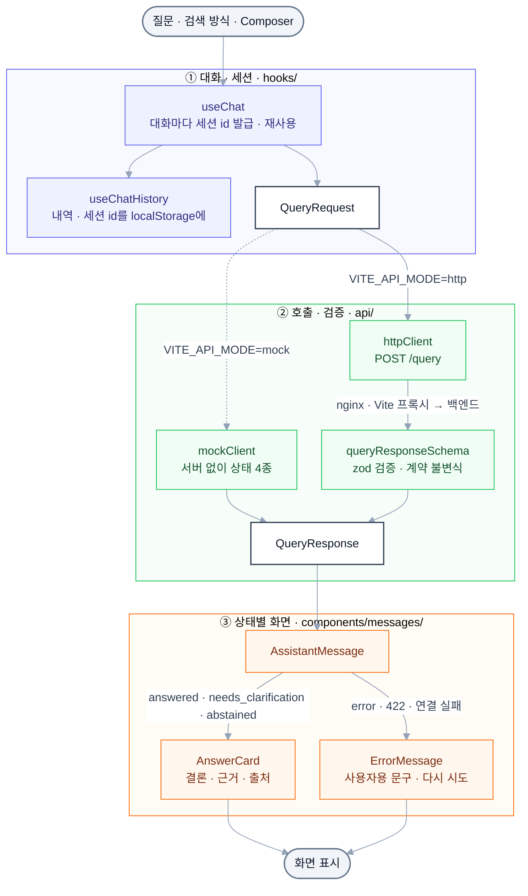

# llm-playground-web

RAG(검색 증강 생성) Q&A 서비스에 붙여 쓰는 채팅형 화면입니다. 질문을 백엔드 `/query`에 보내고, 검색한 자료를 근거로 한 결론 · 근거 · 출처(문서명 · 쪽)를 보여 줍니다. 검색 방식(Dense · 하이브리드 · 하이브리드 + 리랭킹)을 바꿔 결과를 비교할 수 있고, 같은 대화의 질문은 같은 세션 id로 보내 앞 문맥을 잇습니다. 팀 프로젝트(가온루트해운 업무 Q&A) 화면을 개인 프로젝트용 기본 골격으로 옮긴 것입니다.

## 전체 흐름



## 폴더 구조

```
llm-playground-web/
├─ src/
│  ├─ api/          백엔드 계약 · 호출 (types.ts · schemas.ts · client.ts · httpClient.ts · mockClient.ts)
│  ├─ hooks/        대화 · 세션(useChat) · 내역 저장(useChatHistory) · 서버 상태(useHealth) · 화면 보조 훅
│  ├─ lib/          순수 함수 · 설정 (config.ts · chat.ts · history.ts · labels.ts · storage.ts · logger.ts)
│  ├─ components/   화면 (ChatView · Composer · Sidebar · Citations · MessageMeta · messages/AnswerCard …)
│  ├─ providers/    API 클라이언트 · 저장소 주입 (ApiProvider · StorageProvider)
│  ├─ App.tsx       화면 조립 (사이드바 · 헤더 · 대화 · 입력창)
│  └─ main.tsx      시작점. VITE_API_MODE로 실제 · 목업 클라이언트를 골라 주입
├─ docker/          nginx 설정 견본 (nginx.conf.template)
├─ Dockerfile       빌드(Node) → 서빙(nginx) 이미지
├─ compose.yaml     Docker 실행용 compose (web 서비스)
├─ .env.example     compose 설정 견본
├─ vite.config.ts   개발 서버 · /health · /query 프록시
├─ frontend-features.md  팀 프로젝트의 기능 목록 · 구조 작업 계획 (참고용)
└─ package.json     의존성 · 스크립트 (npm)
```

## 기술 스택

| 구분          | 사용                                          |
| ------------- | --------------------------------------------- |
| 언어 · 환경   | TypeScript 6, Node.js 24, npm                 |
| 화면          | React 19, Vite 8, Tailwind CSS 4 (typography) |
| 응답 검증     | zod 4                                         |
| 답변 표시     | react-markdown, remark-gfm                    |
| 실행 · 서빙   | Docker Compose, nginx (`nginx:stable-alpine`) |
| 백엔드 (별도) | RAG Q&A API — `GET /health` · `POST /query`   |

## 빠르게 실행해 보기

[Docker Desktop](https://docs.docker.com/desktop/)(또는 Docker Engine + Compose v2)을 설치하고 실행해 둔 상태에서 시작합니다. Node는 필요 없습니다.

### 1. 받기

<!-- TODO: 저장소 주소가 정해지면 바꾼다 (팀 모노레포 web/ 또는 별도 레포) -->

```bash
git clone <저장소 주소>
cd llm-playground-web
```

### 2. 실행

```bash
docker compose up -d --build
```

`compose.yaml`은 Node로 화면을 빌드한 뒤 nginx 컨테이너를 8080 포트에 띄웁니다. nginx는 `/health` · `/query`를 `BACKEND_URL`(기본 `http://host.docker.internal:8000`, 즉 내 PC에서 띄운 8000번 백엔드)로 넘기므로 CORS 설정이 필요 없습니다.

### 3. 확인

http://localhost:8080 을 엽니다.

```bash
curl -s http://localhost:8080/health
```

백엔드가 떠 있으면 `{"status":"ok","index_ready":true, …}`가 오고 사이드바에 "서버 정상"이 보입니다. 백엔드가 꺼져 있으면 502가 오고 사이드바는 "연결 안 됨"입니다. PowerShell에서는 `curl.exe -s http://localhost:8080/health`로 부릅니다.

### 4. (선택) 백엔드 없이 목업으로 보기

```bash
cp .env.example .env
```

`.env`에서 `VITE_API_MODE=mock`으로 바꾸고 `docker compose up -d --build`로 다시 띄웁니다(PowerShell은 `Copy-Item .env.example .env`). 목업은 서버 없이 상태 4종을 흉내 내며, 사이드바는 항상 "서버 정상"입니다. 상태 확인과 로그는 `docker compose ps` · `docker compose logs -f web`, 멈출 때는 `docker compose down`입니다.

## 설정

Docker 실행은 `.env`(견본 [.env.example](.env.example))를, 개발 서버는 `.env.local`을 읽습니다.

| 항목                 | 변수            | 값 · 기본값                                                                                | 없으면                                            |
| -------------------- | --------------- | ------------------------------------------------------------------------------------------ | ------------------------------------------------- |
| 화면 포트 (Docker)   | `WEB_PORT`      | 기본 `8080`                                                                                | 8080에 연다                                       |
| API 연결 방식        | `VITE_API_MODE` | `http` (실제 백엔드) · `mock` (목업). 빌드 때 정해져 바꾸면 `--build`                      | 개발 서버는 목업, 운영 빌드(Docker 포함)는 `http` |
| 백엔드 주소 (Docker) | `BACKEND_URL`   | 기본 `http://host.docker.internal:8000`. 같은 compose 서비스면 `http://<서비스 이름>:8000` | 내 PC의 8000번으로 보낸다                         |
| API 주소 (개발 서버) | `VITE_API_BASE` | 다른 주소의 API를 직접 부를 때 `http://주소:포트`                                          | 같은 주소로 보내고 Vite 프록시가 넘긴다           |

`BACKEND_URL`은 컨테이너만 다시 띄워도(`docker compose up -d`) 반영됩니다. `VITE_API_BASE`로 다른 주소를 직접 부르면 브라우저가 CORS를 확인하므로 그 화면 주소를 백엔드 허용 목록에 넣어야 합니다.

## 화면

| 경로 | 화면    | 설명                                                                                |
| ---- | ------- | ----------------------------------------------------------------------------------- |
| `/`  | RAG Q&A | 검색 방식 선택 · 질문 입력 · 상태별 답변 · 질문 내역(대화 = 세션) · 서버 상태 한 줄 |

응답 상태마다 다르게 보여 줍니다.

| `status`              | 화면                                                                               |
| --------------------- | ---------------------------------------------------------------------------------- |
| `answered`            | 결론 → 근거 → 출처("manual.pdf 9쪽", 같은 문서 · 쪽은 한 번)                       |
| `needs_clarification` | 파란 상자에 확인 질문 · "조건 보완해서 묻기" 버튼 → 같은 세션에 빠진 조건만 보낸다 |
| `abstained`           | 노란 상자에 보류 사유 · 확보할 자료 (오류와 구분)                                  |
| `error`               | 빨간 상자에 `error_code`별 사용자용 문구 · 다시 시도 (코드 · 서버 원문은 로그에만) |

답변 아래에는 검색 방식 · 캐시 여부 · 응답 시간 · 토큰 · 요청 ID(복사, Langfuse 조회용)가 붙습니다.

## 사용하는 백엔드 API

기준은 팀 프로젝트의 계약 `packages/common/src/common/{types,api}.py`(RAG Q&A 인터페이스 계약 뷰어)이고, 다른 백엔드에 붙일 때는 이 계약 모양으로 응답하게 맞추거나 화면 쪽 스키마를 고칩니다. 화면은 [src/api/schemas.ts](src/api/schemas.ts) 한 곳에서 검증 · 변환합니다.

| 메서드 | 경로      | 내용                                                                                                                                                            |
| ------ | --------- | --------------------------------------------------------------------------------------------------------------------------------------------------------------- |
| GET    | `/health` | 30초마다 확인. `index_ready=false`면 "서버 준비 중", `supported_modes`로 검색 방식 선택지를 좁힘                                                                |
| POST   | `/query`  | `{"question", "retrieval_mode", "session_id"}` → `QueryResponse`. 답변 3종은 200, `status=error`는 503 · 502 · 504 · 500 + 같은 모양 본문, 입력 검증 실패는 422 |

`retrieval_mode`는 `naive` · `hybrid` · `hybrid_rerank`(화면 기본 `hybrid_rerank`), `session_id`는 대화마다 하나(최대 128자)입니다. 지금은 브라우저가 세션 id를 만들어 질문 내역과 함께 localStorage에 저장하고, 서버 세션(`/session` · Redis)이 생기면 [src/api/httpClient.ts](src/api/httpClient.ts)의 `createSession`만 바꿉니다.

#### 응답 예시 (`POST /query`, 계약 예시)

요청: `{"question": "2026년 11월 2일 기준 장비 A의 자동 화면 꺼짐 시간은 몇 분인가요?", "retrieval_mode": "hybrid", "session_id": "…"}`

```json
{
  "request_id": "demo-001",
  "status": "answered",
  "answer": "2026년 11월 2일 기준 장비 A의 자동 화면 꺼짐 시간은 15분입니다.",
  "reason": "장비 A에 적용되는 정정 공지가 기존 10분을 15분으로 바꿉니다.",
  "citations": [{ "source_id": "S2", "book_id": "DEMO_NOTICE", "file_name": "DEMO_NOTICE.pdf", "page": 1 }],
  "error_code": null,
  "meta": {
    "retrieval_mode": "hybrid",
    "latency_ms": 1840.5,
    "input_tokens": 612,
    "output_tokens": 74,
    "cache_hit": false,
    "trace_id": "demo-trace-001"
  }
}
```

| 필드                | 내용                                                                                                                                                        |
| ------------------- | ----------------------------------------------------------------------------------------------------------------------------------------------------------- |
| `status`            | `answered` · `needs_clarification` · `abstained` · `error`                                                                                                  |
| `answer` · `reason` | 결론 · 근거. 확인 질문이면 되묻는 문장, 보류면 보류 이유                                                                                                    |
| `citations`         | 출처. `answered`면 1개 이상. 화면은 `file_name` · `page`만 쓰고 `source_id`는 내지 않음                                                                     |
| `error_code`        | `status=error`일 때만, 반드시 (`index_not_ready` · `retrieval_failed` · `model_timeout` · `model_failed` · `output_invalid` · `ingest_failed` · `internal`) |
| `meta`              | 실제 검색 방식 · 시간 · 토큰 · `cache_hit` · `trace_id`                                                                                                     |

계약의 불변식(`error_code` 조건, `answered`의 출처 1개 이상)을 어긴 응답은 화면에 "서버 응답 형식이 올바르지 않습니다"로 보입니다. 계약은 TS 타입을 `contracts/openapi.json`에서 생성하는 것을 원칙으로 하지만, 아직 그 파일이 없어 [src/api/types.ts](src/api/types.ts)를 손으로 옮겨 두었습니다(전환 계획은 [frontend-features.md](frontend-features.md) 5번).

## 알아 둘 점

- **같은 대화의 질문은 같은 세션으로 이어집니다.** 확인 질문을 받으면 빠진 조건만 적어 보내면 되고, 새 대화는 "+ 새 질문"입니다.
- **질문 내역 · 세션 id는 이 브라우저에만 저장됩니다** (localStorage, 최신 200개). 저장할 수 없는 환경(시크릿 창 등)에서도 화면은 동작합니다.
- **오류는 사용자용 문구만 보입니다.** `error_code`와 서버 원문은 브라우저 콘솔 로그에 남고, 화면에는 요청 ID가 함께 보여 Langfuse에서 찾을 수 있습니다.
